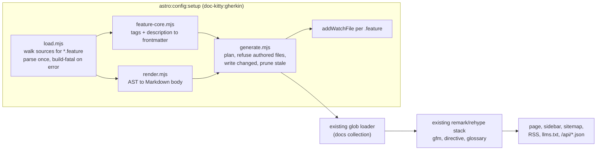

# Gherkin feature pages

The opt-in `gherkin` preset reads a repository's Gherkin `.feature` files, parses
each one once with the official `@cucumber/gherkin` parser, and writes one
`kind: Specification` Markdown page per feature into the docs collection, plus a
hub page per directory. From there the pages are ordinary collection files. The
sidebar, sitemap, RSS, `llms.txt`, the agent API, glossary auto-linking and the
`related`/`audience` blocks all pick them up with no new wiring. This page maps
the surface. The decision behind it is
[ADR-0046](../adr/0046-gherkin-feature-pages.md), and that record stays
authoritative.

Audience: contributors working on `src/lib/gherkin/`, and site maintainers who
want to know what the preset does to their tree. How to write the `.feature` files
is in [Authoring behaviour specs](../guides/authoring.md#authoring-behaviour-specs);
how to switch the preset on is in
[consumer setup](../guides/consumer-setup.md#optional-gherkin-feature-pages).

## Pipeline

Everything after `generate.mjs` is existing code. The preset adds **no**
remark or rehype plugins, so the plugin-order pins don't change.

The four modules are plain JSDoc-typed `.mjs` with no Astro imports:

| Module | Role | Imports |
|--------|------|---------|
| `load.mjs` | Discover and parse. Walks each source directory, skipping dot-directories and `node_modules` and following symlinks without revisiting a directory. Parses each file with a fresh `IdGenerator.incrementing()`. Collects **every** syntax error in every file, then throws one `[dk-gherkin] <path>:<line>:<col> <message>` error. A missing source directory is fatal. A file with no `Feature:` is skipped with a warning. | `node:*`, `@cucumber/gherkin`, `@cucumber/messages` |
| `feature-core.mjs` | Pure tag and description mapping to ordered frontmatter. Returns warnings; never throws on author input. | `vocabulary-core.mjs`, `text.mjs` |
| `render.mjs` | Pure AST to Markdown body, including escaping. | `text.mjs` |
| `generate.mjs` | `planFeaturePages()` builds the path-to-contents map. `generateFeaturePages()` writes it. `diffFeaturePages()` compares it with the tree for `--check`. | `node:*`, `gray-matter`, the modules above |

`text.mjs` holds the one dedent and narrative-split rule that both the metadata
core and the renderer use.

## The generation seam

The preset reuses the glossary's seam
([ADR-0026](../adr/0026-glossary-source-and-generation-seam.md)): it writes real
`.md` files under `<docsDir>/<section>/` in `astro:config:setup`. Astro's
content-layer glob runs after every config hook, so the files are on disk before
`getCollection('docs')` reads them. The bare-Node gates walk files on disk, so they
see the pages too. An injected route or a composite content loader would hide the
pages from both. ADR-0046 records the rejected alternatives.

The integration, `doc-kitty:gherkin`, exists only when the `gherkin` option is
set. With the option absent the integrations array and the markdown config are
byte-identical to a site without it. When present, it sits immediately after the
glossary integration and before Starlight, so the log reads glossary, then
gherkin. Its section id is appended to the registry sidebar's build-generated ids,
so a first build with no committed output doesn't warn about a missing section.

The option is validated when `defineDocKittyIntegrations` runs, before any hook:

- `sources` must be a non-empty array of non-empty strings.
- `section` must be a single path segment: not empty, no `/` or `\`, no leading
  `.`. It can't be `_meta` or another generator's section (`glossary`).

## Paths, pages and hubs

`<source>/shipping/book-consignment.feature` becomes
`<docsDir>/<section>/shipping/book-consignment.md`. Each path segment goes through
the toolkit's single `slug()` rule in `vocabulary-core.mjs`. Every source directory
is generated under the same section root.

Hubs are written for the section root and for every directory that holds a
feature anywhere below it. The hub file is `<first indexBasename>.md`, so
`README.md` by default. Using the first configured basename makes the hub collapse
to its directory route under either loader setting. A hub has `kind: Hub`,
`doc_status: active`, a one-line intro and a list of its children
(`- [<title>](./<slug>/) — <description>`), sorted by output path. The root hub's
title is the section's registry label, or the humanised section id. A directory
hub's title is the humanised directory name, and its description reads
"Behaviour specifications for `<Title>`, generated from Gherkin feature files."

These are fatal, and name the files involved:

- **Output collision.** Two sources map to the same output path.
- **Index collision.** A feature whose slugged file name is an index basename
  (`README.feature`, or `index.feature` when `indexBasename` includes `index`)
  would be routed as its directory's index and clash with the generated hub.
- **Unsluggable path.** A path segment with no slug-able characters.

## Ownership and pruning

Feature files get renamed and deleted, so unlike the glossary the generator also
removes pages. It never deletes authored content:

1. Every generated page and hub carries `generated.by: "doc-kitty/gherkin"`.
2. Before writing, the generator scans the section folder. A `.md` with that stamp
   is **owned**. Any other file (dotfiles aside) is **authored**, and the run fails
   before any write, naming it. A generated section has a single owner.
3. It writes the planned files whose bytes changed, deletes owned files that are no
   longer planned, then removes directories left empty.
4. With the preset on and no `.feature` files left, it warns once and removes the
   previously generated pages.

## Determinism

Generation is a pure function of the sources and the docs tree it reads (the ADR
listing and the section registry). Files are ordered by source index, then by
code-unit order of the path. Every ordering inside a page uses the same code-unit
comparison, never locale or filesystem order. No clock is read.

`generated.at` holds a content hash, not a timestamp: `sha256:<first 12 hex>` of
the raw source bytes for a feature page, and of the sorted child-path list for a
hub. An agent can tell which version of the source a page reflects, and unchanged
input gives byte-identical output.

The writer skips files whose bytes are unchanged. That matters in dev. Each loaded
`.feature` is registered with `addWatchFile`, so editing one restarts the dev
server, which re-runs the generator. Byte-stable output means the restart doesn't
retrigger itself.

## The mapping contract, in brief

Feature-level tags in the reserved `@dk:<key>=<value>` namespace are the only
metadata channel. The value is everything after the first `=`.

| Tag | Frontmatter |
|-----|-------------|
| `@dk:context=<ctx>` | `glossary_context` |
| `@dk:status=<s>` | `doc_status`, passed through as written |
| `@wip` / `@deprecated` | `doc_status: draft` / `deprecated`, when no `@dk:status` |
| none of the above | `doc_status: active` |
| `@dk:persona=<slug>` | an `audience` entry; `guidance_text` is the feature's narrative |
| `@dk:mission=<slug>` | `related: <mission prefix>/<slug>` |
| `@dk:adr=<n>` | `related: adr/<NNNN-…>`, resolved against `<docsRoot>/adr/` |
| `@dk:related=<slug>` | `related: <slug>` |
| `@dk:updated=<YYYY-MM-DD>` | `updated` |
| `@dk:autolink=false` | `glossary_autolink: false` |
| `@dk:priority=<0..1>` | `agent.priority` |
| any other feature tag | `tags`, without the `@` |

The full rules, with examples, are in
[Authoring behaviour specs](../guides/authoring.md#authoring-behaviour-specs). The
points that matter for maintainers:

- **Warnings, not failures.** An unknown `@dk:` key (with a did-you-mean
  suggestion), a missing value, a repeated single-valued key (the first wins), or
  an invalid `updated`, `priority` or `autolink` value warns and is ignored. A
  dangling persona, mission, ADR or related ref fails through the existing link and
  audience gates, not here.
- **Mission prefix.** It comes from the section registry: the first section with a
  `subtypes` rule of `type: Mission` gives `<section>/<match>`, so `plans/missions`
  in the example. Without one it falls back to `plans` and warns.
- **`type` is not emitted.** The section's registry entry supplies
  `type: Specification`, keeping the type authority in one place.
- **Description.** The first sentence of the feature description after any leading
  `As a / I want / So that / In order to` narrative. A narrative-only description
  uses the joined narrative. An empty one uses
  "Behaviour specification for `<name>`." with a warning. Over 180 characters it is
  cut at a word boundary with `…` and a warning.

The body puts the feature at `#`. Rules are `##` with their children at `###`;
without rules, backgrounds and scenarios are `##`. Steps are list items
(`- **Given** …`), which keeps them prose so glossary auto-linking reaches them.
Outline placeholders become inline code, data tables become nested GFM tables, and
docstrings become nested fences. Examples are a bold label and a table, not a
heading, so the table of contents lists rules and scenarios only. Rule, scenario
and examples tags render inline as code, de-duplicated and in code-unit order.
Comments aren't rendered.

The renderer departs from, or extends, the plan's contract in a few places, each
for a lint or parser reason:

- A docstring with no media type gets the `text` info string (markdownlint MD040).
- In literal text, `~` is backslash-escaped (GFM strikethrough). So is a `:` that
  precedes a character able to start a directive name, such as a letter or digit,
  because `remark-directive` reads `word:name` and even `10:30` as a text directive
  without any `[label]`.
- A name that looks like an ordered-list item (`1. …`) escapes the `.` or `)`, and a
  trailing `#` run in a heading is escaped so it isn't read as a closing sequence.
- A newline in a table cell renders as ` `.

Duplicate scenario names under one parent produce duplicate sibling headings. The
generator warns with both line numbers, and markdownlint's MD024 fails CI, so the
author fixes the name at source.

## Gate parity and the drift gate

The pages are committed, like the glossary's. Two gates keep them honest:

- **Frontmatter parity.** `validate-frontmatter.mjs` recognises a generated page by
  its `generated.by` stamp (`doc-kitty/glossary` or `doc-kitty/gherkin`), or by the
  legacy glossary path rule. Generated pages are exempt from `type`, and from
  `updated` unless a `@dk:updated` tag supplied one, in which case the value is
  checked normally. `check-links.mjs` needs no change: generated `related` refs are
  ordinary slugs, so a dangling one fails like any other.
- **Drift gate.** `src/scripts/generate-feature-pages.mjs`, shipped as the
  `dockitty-generate-feature-pages` binary, calls the same `loadFeatures` and
  `planFeaturePages` the integration calls, so the bytes it compares are the bytes
  the build writes. With `--check` it writes nothing and exits 1 listing every
  `added`, `changed`, `stale` and `authored` path. Its flags mirror the `gherkin`
  option because the script can't evaluate `astro.config.mjs`. In this repo,
  `pnpm validate:features` runs it against the example in the CI doc-sanity lane,
  and `pnpm generate:features` regenerates.

## Agent surface

The pages reach `llms.txt` and `/api/index.json` under the section's registry
label. `/api/pages/<id>.json` returns the generated Markdown plus
`sources: [{ resource, title: "Gherkin source" }]`. The resource is the source path
relative to `gherkin.sourceRoot`, prefixed with `gherkin.sourceUrlPrefix` when set,
so an agent can fetch the executable `.feature` itself.

## Limits

- **New files need a restart.** Only the `.feature` files loaded at startup are
  watched, so a new file appears after the next dev-server restart.
- **English-only narrative detection.** The `As a / I want / So that / In order to`
  lines are matched in English. Keywords such as `Given` render as written, so
  localised features keep their keywords, but a localised narrative is treated as
  ordinary description text.
- **No outline expansion.** A Scenario Outline renders once with its examples
  table. Per-row expansion belongs to the results phase.
- **Turning the preset off freezes the pages.** With no integration, nothing
  prunes the section, so the last generated pages keep building as ordinary
  content. Removing the feature means deleting the section folder. If CI still runs
  the `--check` gate, it reports the drift.
- **Registry source.** The generator reads the section label and the mission
  subtype from `docs/_meta/sections.yaml`. A registry declared only in
  `_meta/charter.yaml` isn't consulted there, so the root hub title falls back to
  the humanised section id and mission refs to `plans/<slug>`.

## Related follow-ups

- The glossary generator writes `index.md` regardless of `indexBasename`, so under
  the default `README`-only setting its hub lands at `/glossary/index/`. The
  Gherkin hubs use the first configured basename and don't have this problem.
- Phase 2 attaches pass/fail results per scenario from a Cucumber results file,
  as described in the [QA portal research](./research/qa-portal.md).
